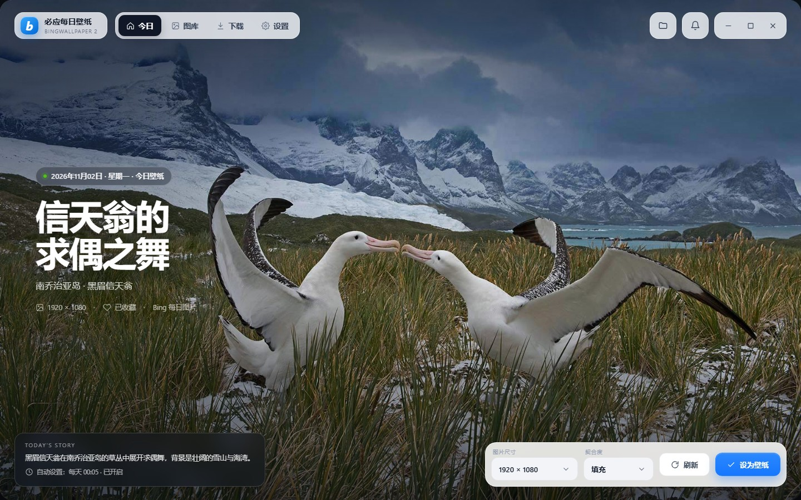
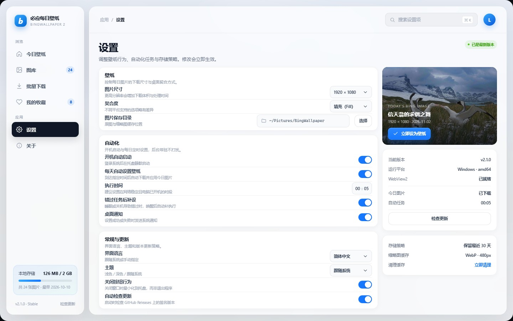
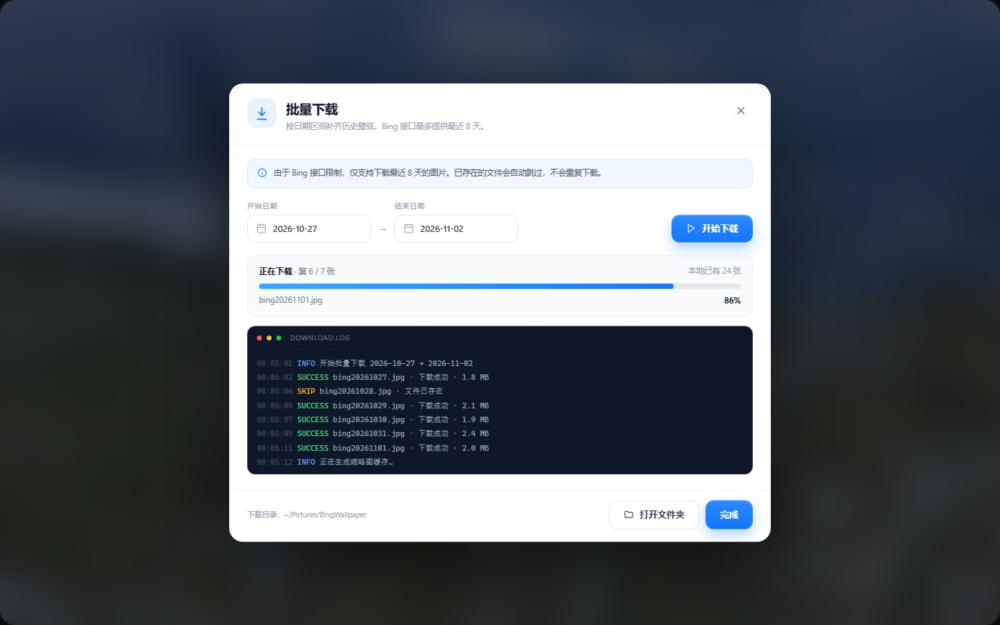

# BingWallpaper

必应每日壁纸的跨平台复刻版：每天自动获取 Bing 首页图片，缓存到本地并设置为桌面壁纸，同时提供图库、收藏、批量下载与定时任务。

原项目 BingWallpaper2 是 WPF / .NET Framework 4.7.2 的 Windows-only 应用（AGPL-3.0）。本仓库用 **Rust + Tauri 2 + Vue 3** 独立重写，支持 Windows、macOS 与 Linux；原项目源码仅作行为参照，未随本仓库分发。

## 界面预览

| 主界面 | 图库 |
|---|---|
|  |  |

| 设置 | 批量下载 |
|---|---|
|  |  |

## 功能

- **每日壁纸**：自动拉取 Bing 当日图片，下载后按所选填充模式应用到桌面。
- **四种分辨率**：UHD 4K、1920×1200、1920×1080（默认）、1366×768。
- **图库**：分页、搜索、全部 / 收藏 / 最近 7 天筛选、列表与网格两种视图。
- **图库目录扫描**：把保存目录指向已有壁纸的文件夹，应用会自动索引、补齐缩略图并显示进度；扫描来的图片只建索引，从图库删除不会动你的原文件。
- **批量下载**：按日期区间下载最近 8 天内的图片，带进度、取消与跳过已存在项。
- **定时任务**：每天在指定时间设置壁纸；错过后可补跑（catch-up）。
- **托盘常驻**：显示主窗口、立即设置、打开图库、打开设置、退出。
- **系统集成**：开机自启（用户级）、系统通知、单实例、窗口位置记忆。
- **存储管理**：设置图片目录、按保留天数清理缓存（`0` 表示不清理）、统计占用空间。
- **中英双语**：跟随设置的 `zh-CN` / `en-US`，浅色 / 深色 / 跟随系统主题。

## 技术栈

| 层 | 选型 |
|---|---|
| 桌面壳 | Tauri 2.12（WebView2 / WKWebView / WebKitGTK） |
| 后端 | Rust 2021：reqwest、rusqlite、image、chrono、tokio |
| 前端 | Vue 3.5、TypeScript 5.9、Vite 8、Ant Design Vue 4、Pinia、vue-i18n |
| 打包 | Tauri Bundler（NSIS / MSI、dmg / app、deb / AppImage / rpm） |

## 目录结构

```text
.
├── src/                     # Vue 3 前端
│   ├── api/                 # Tauri 命令封装 + 浏览器 mock 后端
│   ├── components/          # 通用组件
│   ├── composables/         # 主题、通知、事件订阅
│   ├── layouts/             # 沉浸式 / 管理页外壳
│   ├── locales/             # zh-CN、en-US
│   ├── stores/              # Pinia
│   └── views/               # Home / Gallery / Downloads / Settings / About
├── src-tauri/               # Rust 后端
│   ├── src/commands/        # #[tauri::command] 入口
│   ├── src/domain/          # 模型、错误、平台 trait
│   ├── src/services/        # Bing、图库、壁纸、缩略图、调度、更新
│   ├── src/infra/           # HTTP、SQLite、文件、平台适配
│   ├── capabilities/        # Tauri 权限
│   └── tauri.conf.json
├── docs/复刻方案.md          # 原项目解读与完整复刻方案
└── docs/mockups/            # 界面示意图与 HTML 原型
```

## 开发环境

- Node.js ≥ 20（验证于 24.x）
- Rust ≥ 1.90（验证于 1.99）
- Tauri 2 的系统依赖

### Windows

- **MSVC 工具链（推荐）**：安装 Visual Studio Build Tools 的「使用 C++ 的桌面开发」工作负载，然后
  ```powershell
  rustup default stable-x86_64-pc-windows-msvc
  ```
- **GNU 工具链**：需要 MinGW-w64 的 `gcc` / `dlltool` / `ar` / `windres`。若使用 MSYS2，请把 `C:\msys64\mingw64\bin`（ucrt64 则是 `C:\msys64\ucrt64\bin`）加入 `PATH`，否则会出现
  `error calling dlltool 'dlltool.exe': program not found`；`npm run tauri:dev` 另会报 `tauri-winres ... NotAttempted("windres")`，同一个目录缺 `windres.exe` 导致的。
- WebView2 Runtime：Windows 10/11 通常已内置。

### macOS

```bash
xcode-select --install
```

### Linux（Debian / Ubuntu 系）

```bash
sudo apt install libwebkit2gtk-4.1-dev build-essential curl wget file \
  libxdo-dev libssl-dev libayatana-appindicator3-dev librsvg2-dev
```

## 运行与构建

```bash
npm install

# 仅前端（浏览器中运行，使用 mock 数据，可调试 UI）
npm run dev

# 桌面端开发（真实 Rust 后端 + Vite HMR）
npm run tauri:dev

# 前端静态检查
npm run lint

# 前端类型检查 + 产物构建
npm run build

# 打包当前平台安装包
npm run tauri:build
```

> 1420 端口同时只能有一个 dev server。若本机另一个 Tauri 项目已占用，`npm run tauri:dev` 会连到别人的页面。绕法：另起 `npx vite --port 1421`，再用一个只写 `build.devUrl` 的临时 JSON 覆盖配置文件跑 `npm run tauri:dev -- --config dev-port.json`（内容与 `tauri.conf.json` 合并，只覆盖这一个键）。

## 测试与质量

| 检查 | 命令 | 说明 |
|---|---|---|
| 前端静态检查 | `npm run lint` | ESLint 10 扁平配置 + `typescript-eslint` + `eslint-plugin-vue`，`--max-warnings 0` |
| 前端单元测试 | `npm run test:unit` | Vitest + jsdom，覆盖 `utils/format`、`utils/error`、`stores/settings`、`stores/gallery`（34 用例） |
| 前端类型检查 | `npm run build` | `vite build` + `vue-tsc --noEmit` |
| Rust 静态检查 | `cd src-tauri && cargo clippy --all-targets -- -D warnings` | 零警告门禁 |
| Rust 测试 | `cd src-tauri && cargo test` | 单元测试 + wiremock 集成测试（Bing 正常 / 空 / 500 / 畸形 JSON） |

> **Windows GNU 工具链提示**：在 `stable-x86_64-pc-windows-gnu` 下，Tauri lib 的测试 harness 可能在加载期报 `STATUS_ENTRYPOINT_NOT_FOUND` 而无法启动（GUI 主程序不受影响，可正常运行）。请改用 MSVC 工具链运行 `cargo test`，或直接依赖 CI。此外 GNU 链接 `cdylib` 会触发 MinGW `export ordinal too large` 缺陷，故 `Cargo.toml` 的 `crate-type` 收敛为 `["rlib"]`（桌面端足够，移动端不在范围内）。

CI（`.github/workflows/`）：

- `ci.yml`：push / PR 时在 **Windows(MSVC) / Ubuntu / macOS** 上运行 ESLint、clippy `-D warnings`、`cargo test`、前端 build + Vitest——本机 GNU 跑不了的后端测试由 CI 实跑。
- `release.yml`：推送 `v*` tag 时按 **Windows x64、macOS arm64、macOS x64** 三个原生 runner 打包，产出草稿 Release；正文直接取 annotated tag 的注释，所以发布用 `git tag -a` 并把更新说明写进注释。

交叉编译 arm64：

```bash
# Windows on ARM
rustup target add aarch64-pc-windows-msvc
npm run tauri:build -- --target aarch64-pc-windows-msvc

# Apple Silicon
rustup target add aarch64-apple-darwin
npm run tauri:build -- --target aarch64-apple-darwin

# Linux arm64
rustup target add aarch64-unknown-linux-gnu
npm run tauri:build -- --target aarch64-unknown-linux-gnu
```

> macOS 通用二进制可分别构建 `aarch64-apple-darwin` 与 `x86_64-apple-darwin` 后用 `lipo` 合并；Linux arm64 需要对应的交叉链接器。

## 数据与隐私

| 内容 | 位置 |
|---|---|
| 设置 | `<AppData>/com.bingwallpaper.app/settings.json` |
| 图片库元数据 | `<AppData>/com.bingwallpaper.app/library.db`（SQLite，WAL） |
| 原图 | `<AppData>/com.bingwallpaper.app/images/` 或用户自定义目录 |
| 缩略图 | `<AppData>/com.bingwallpaper.app/thumbnails/` |

- Windows：`%APPDATA%\com.bingwallpaper.app`
- macOS：`~/Library/Application Support/com.bingwallpaper.app`
- Linux：`~/.local/share/com.bingwallpaper.app`

网络请求仅发往 `bing.com`（图片与 `HPImageArchive` 接口）和 `api.github.com`（检查更新）。没有遥测，也不会上传本地图片。更新采用「检查 GitHub Release → 打开下载页面」，客户端不保存任何云存储密钥。

## 平台支持矩阵

| 平台 | 壁纸方式 | 填充模式 |
|---|---|---|
| Windows | `IDesktopWallpaper` COM（多显示器 + 契合度）；失败回退 `SystemParametersInfoW` + HKCU 注册表 | 填充 / 适应 / 拉伸 / 平铺 / 居中 / 跨屏 |
| macOS | `osascript` + System Events | 仅填充 |
| GNOME / Cinnamon / Budgie 等 | `gsettings` | 全部 |
| KDE Plasma | `plasma-apply-wallpaperimage` | 仅填充 |
| XFCE | `xfconf-query`（每个显示器属性） | 全部 |
| Sway | `swaymsg output * bg` | 填充 / 适应 / 拉伸 / 平铺 / 居中 |
| Hyprland | `hyprctl hyprpaper` | 仅填充（`cover`） |
| 其他 X11 | `feh` | 全部 |

开机自启统一为**用户级**：Windows `HKCU\...\Run`、macOS LaunchAgent、Linux XDG autostart，无需管理员权限。

当前平台不支持的契合度在设置页会置灰；早期版本存进 `settings.json` 的不支持值会在启动时被自动改回**填充**并回写文件，避免定时任务每次都设置失败。

## 文档

- [完整复刻方案](docs/复刻方案.md)：原项目逐模块解读、架构设计、命令与事件清单、迁移与测试计划
- [HTML 界面原型](docs/mockups/ui-mockup.html)

## 许可证

本项目沿用原项目的 **AGPL-3.0**（见 [LICENSE](LICENSE)）。分发修改版时需同样以 AGPL-3.0 开源，并向网络交互用户提供对应源码。Bing 图片版权归 Microsoft / 原作者所有，本项目仅作个人壁纸用途，请遵守 Bing 的使用条款。
