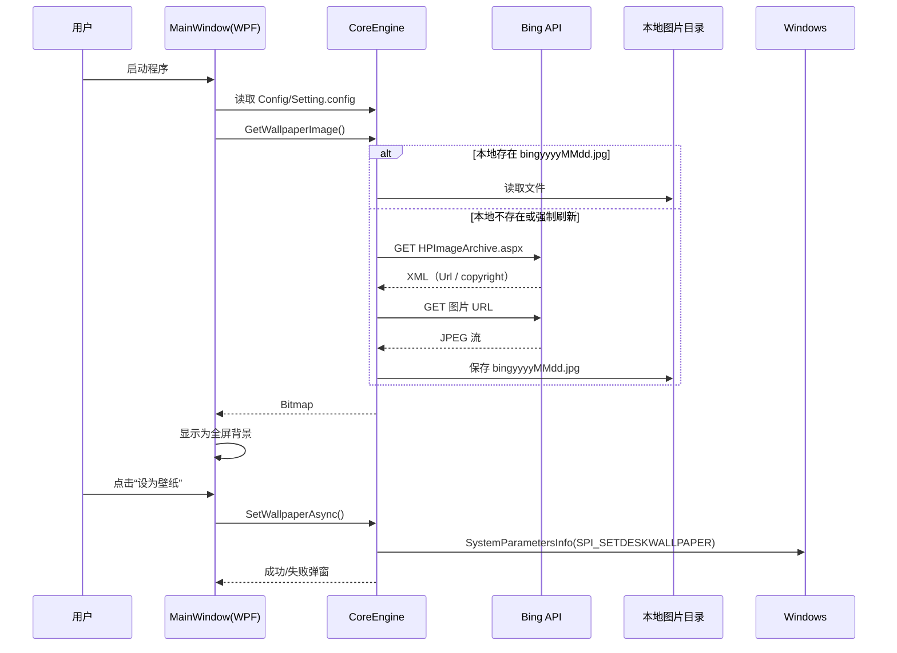
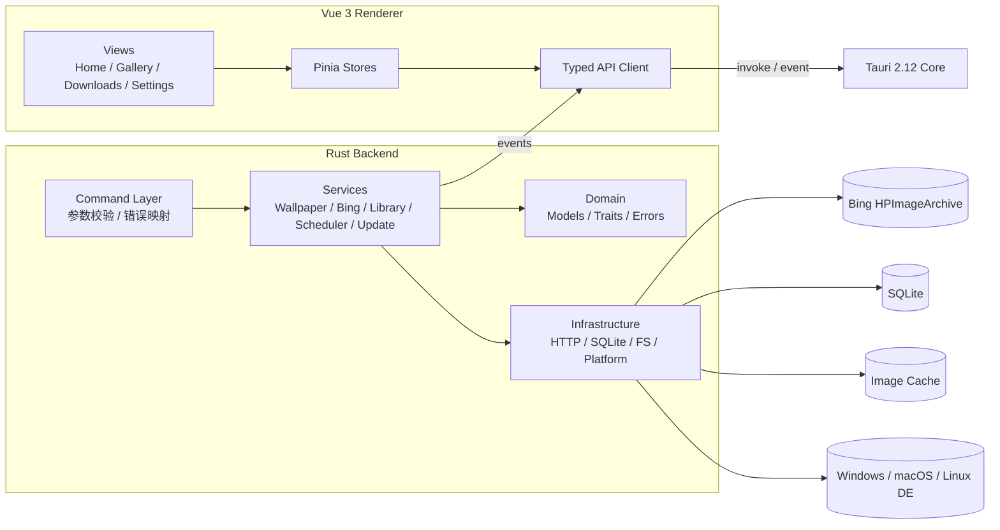
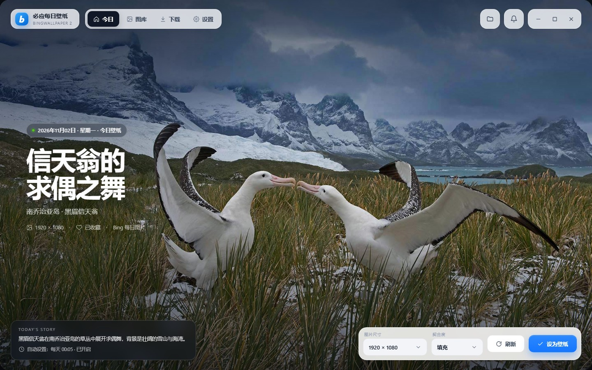
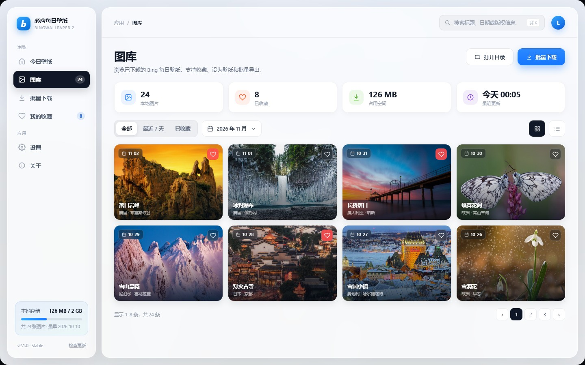
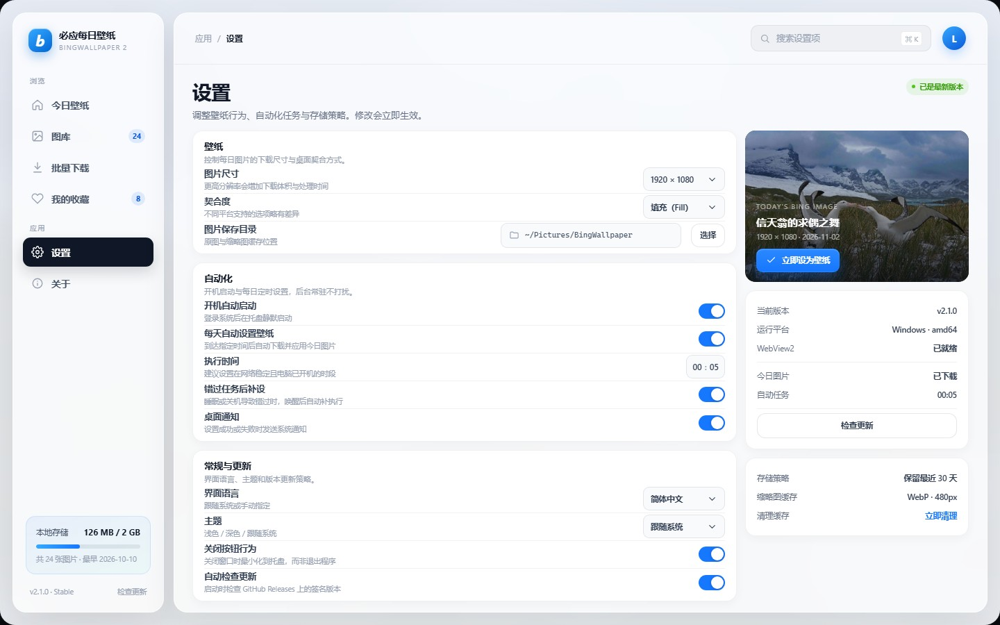
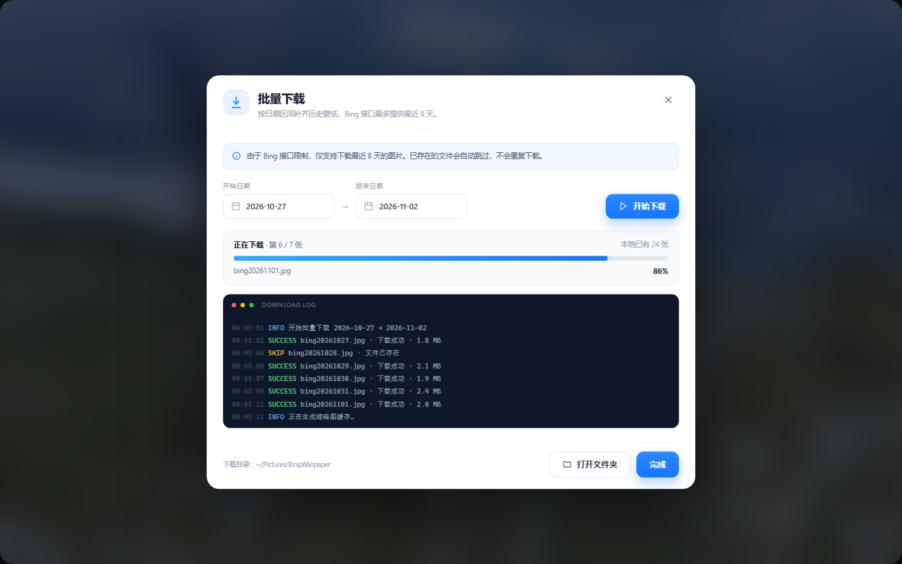

# BingWallpaper2 跨平台复刻方案

> 技术栈：Rust + Tauri 2.12 + Vue 3 + Ant Design Vue + Pinia  
> 目标平台：Windows / macOS / Linux，amd64 + arm64  
> 文档定位：项目解读、架构设计、跨平台实现、界面示意、构建发布与实施计划

---

## 0. 结论摘要

原项目 `BingWallpaper2` 是一个 **Windows-only 的 WPF/.NET Framework 4.7.2 桌面应用**：核心逻辑很小，主要是“取 Bing 每日图 → 下载缓存 → 调 Win32 API 设置壁纸”，外围再包一层托盘、定时任务、批量下载、设置和自动更新。

复刻建议采用 **“Rust 做系统能力 + Tauri 做壳 + Vue 做界面”** 的分层架构：

- **Rust**：Bing 接口、下载、图片处理、SQLite、定时任务、托盘、单实例、开机自启、跨平台壁纸适配、更新校验。
- **Tauri 2.12**：窗口、IPC、权限、插件、打包、签名更新。
- **Vue 3 + Ant Design Vue + Pinia**：沉浸式主界面、图库、批量下载、设置、关于。
- **跨平台壁纸**：抽象 `WallpaperBackend` trait，Windows 用 `SystemParametersInfoW` / `IDesktopWallpaper`，macOS 用 `NSWorkspace`，Linux 按桌面环境调用 `gsettings` / `plasma-apply-wallpaperimage` / `xfconf-query` / `swaymsg` / `hyprctl` / `feh`。
- **amd64/arm64**：GitHub Actions 矩阵构建，Windows MSVC、macOS Universal、Linux gnu 三套产物；签名更新使用 `tauri-plugin-updater`，不再把云密钥写进客户端。

原项目最需要修正的三件事：

1. **去掉硬编码的腾讯云 SecretId/SecretKey**，改用 GitHub Releases + 签名更新清单。
2. **去掉管理员权限依赖**，开机自启用 HKCU / LaunchAgent / XDG autostart，不再写 HKLM。
3. **把 Windows 专属实现收敛到平台适配层**，业务层只依赖 trait，避免平台代码渗透到 UI 和调度逻辑。

---

## 1. 原项目解读

### 1.1 项目组成

| 项目/目录 | 作用 | 关键点 |
|---|---|---|
| `BingWallpaper2` | WPF 主程序 | 5 个窗口：主界面、设置、批量下载、更新、关于 |
| `BingWallpaper.Core` | 核心类库 | `CoreEngine` 单例、`WallpaperManager`、设置读写、文件/图片工具 |
| `BingWallpaperAuto` | 开机自动设置壁纸的独立 exe | 控制台程序，被注册表开机项调用 |
| `BingWallpaper.Alert` | 自定义弹窗库 | 成功/失败/警告提示 |
| `Update` | 独立更新器 | 配合 SevenZipSharp 解压 `.bwp` 更新包 |
| `UnitTest` | 单元测试项目 | 覆盖面有限 |
| `Dist` | 运行时目录 | 图片、配置、依赖 DLL、两个 exe |
| `History` | 历史版本包 | `.bwp` 更新包 |

技术细节：

- .NET Framework **4.7.2**，WPF + WinForms 互操作。
- `FluentScheduler` 做每日定时任务。
- `NLog` 做日志。
- `Vicold.Popup` 做弹窗。
- `Tencent.QCloud.Cos.Sdk` 做对象存储更新检查。
- `IWshRuntimeLibrary` COM 创建桌面快捷方式。
- `System.Drawing.Bitmap` 做图片下载、保存和缩略图。
- 通过 `SystemParametersInfo(20, 1, path, 1)` 设置壁纸，通过注册表设置契合度。

### 1.2 功能清单

| 功能 | 原实现 |
|---|---|
| 获取当天 Bing 图片 | `cn.bing.com/HPImageArchive.aspx?idx=0&n=1`，正则取 `<Url>` |
| 下载并缓存 | 保存为 `Image/bingyyyyMMdd.jpg` |
| 设置桌面壁纸 | Win32 `SystemParametersInfo` |
| 修改图片尺寸 | 把 URL 中的 `1920x1080` 替换为 `1920x1200` / `1366x768` |
| 修改壁纸契合度 | 写 `HKCU\Control Panel\Desktop` 的 `WallpaperStyle` / `TileWallpaper` |
| 开机自动启动 | 写 `HKLM\...\Run`，需要管理员权限 |
| 开机自动设置 | 注册 `AutoRunning.exe` 到 `HKLM\...\Run` |
| 后台常驻 | 主窗口隐藏 + 托盘图标 |
| 每日定时 | FluentScheduler 每天指定时间刷新图片、设置壁纸 |
| 批量下载 | 最近 7 天，进度条 + 日志 |
| 检查更新 | 腾讯云 COS 列举 `.bwp` 文件，比较版本 |
| 单实例 | 枚举同名进程，显示已有窗口 |
| 托盘菜单 | 打开图片文件夹、设置今日壁纸、设置、退出 |
| 设置 | 图片目录、开机自启、自动设置、关闭行为、时间 |
| 关于 | 版本、作者、博客、QQ、GitHub |

### 1.3 核心流程



### 1.4 配置与数据

`Config/Setting.config`：

| Key | 默认值 | 含义 |
|---|---|---|
| `WallpaperSize` | `0` | 0=默认 1080p，1=1200p，2=1080p，3=720p |
| `WallpaperStyle` | `0` | 0=默认填充，1=填充，2=适应，3=拉伸，4=平铺，5=居中，6=跨区 |
| `ImageSavePath` | 空 | 空则使用程序目录 `Image` |
| `CloseJustClose` | `true` | 关闭按钮是否直接退出 |
| `AutoStart` | `false` | 开机自启 |
| `AutoSet` | `false` | 开机自动设置 |
| `AppFirstStart` | `true` | 是否首次启动 |
| `TodayImageCopyright` | 空 | 今日图片版权信息 |
| `AutoSetTime` | `0005` | 每日自动设置时间 HHmm |

`Config/UpdateConfig.xml`：腾讯云 COS 的 AppID、Bucket、Region、SecretId、SecretKey、更新路径。**这是原项目的重大安全问题，复刻时必须移除。**

### 1.5 原项目的主要问题

| 类别 | 问题 | 复刻对策 |
|---|---|---|
| 平台 | WPF、WinForms、注册表、Win32 API，完全 Windows-only | Rust trait + 平台适配层 |
| 权限 | 开机自启写 HKLM，切换开关要 UAC 提权 | HKCU / LaunchAgent / XDG autostart |
| 安全 | 客户端硬编码云存储密钥 | GitHub Releases + minisign 签名 |
| 网络 | 正则解析 XML，接口变动即失效 | JSON API + serde |
| 稳定性 | 大量 `catch {}` 吞异常，失败原因不可见 | `thiserror` 错误类型 + 日志 + 前端提示 |
| 性能 | `BitmapUtil.Zip` 逐像素采样生成缩略图 | `image` crate + 后台缩略图缓存 |
| UI | 固定 800×450，无响应式、无暗色、无多语言 | Vue 3 + Ant Design Vue + i18n + 主题 |
| 功能 | 无图库、无收藏、无多显示器、无任务补跑 | 新增图库、收藏、多显示器、missed-run catch-up |
| 更新 | 下载 `.bwp` 后启动 `Update.exe`，无签名校验 | Tauri updater + 签名 + 原子替换 |
| 测试 | 核心逻辑缺少可测试边界 | 纯函数 + 依赖注入 + mock HTTP |
| 许可 | AGPL-3.0 | 见第 12 节合规说明 |

---

## 2. 复刻目标与范围

### 2.1 目标

1. **功能对齐**：原版所有核心功能在 Windows 上可用。
2. **跨平台**：macOS、主流 Linux 桌面可设置壁纸；不支持的契合度明确置灰并说明原因。
3. **架构可维护**：Rust 业务层不依赖具体平台；前端不直接碰系统 API。
4. **可发布**：Windows x64/ARM64、macOS Intel/Apple Silicon、Linux x64/ARM64 均有安装包。
5. **安全合规**：无客户端密钥、更新签名校验、最小权限、CSP。

### 2.2 功能矩阵

| 功能 | 原版 | 复刻版 | 优先级 |
|---|---|---|---|
| 今日壁纸预览 | ✅ | ✅ 沉浸式全屏 | P0 |
| 获取 Bing 每日图 | XML + 正则 | JSON API + 多市场 | P0 |
| 下载/缓存 | ✅ | ✅ 原图 + 缩略图 + SQLite | P0 |
| 设置壁纸 | Win32 | 跨平台 trait | P0 |
| 图片尺寸 | 3 种 | UHD / 1920×1200 / 1920×1080 / 1366×768 | P0 |
| 壁纸契合度 | 6 种（Windows） | 按平台能力矩阵 | P0 |
| 托盘 | ✅ | ✅ Tauri tray | P0 |
| 单实例 | ✅ | ✅ `single-instance` | P0 |
| 开机自启 | HKLM | HKCU / LaunchAgent / XDG | P0 |
| 每日自动设置 | FluentScheduler | tokio + 补跑 | P0 |
| 批量下载 | 7 天 | 8 天 + 取消 + 跳过已有 | P0 |
| 设置 | 单窗口 | 分组设置页 + 即时保存 | P0 |
| 检查更新 | COS + `.bwp` | GitHub Releases + 签名 | P0 |
| 图库 | ❌ | ✅ 网格、搜索、筛选、分页 | P1 |
| 收藏 | ❌ | ✅ | P1 |
| 多显示器 | ❌ | ✅ Windows 完整；macOS/Linux 尽力 | P1 |
| 多语言 | ❌ | ✅ 中/英 | P1 |
| 暗色主题 | ❌ | ✅ 跟随系统 | P1 |
| 通知 | 自定义弹窗 | 系统通知 + 应用内 message | P1 |
| 自动清理 | ❌ | ✅ 按天数/容量 | P2 |
| 代理 | ❌ | ✅ 系统代理/自定义 | P2 |
| 桌面快捷方式 | COM | 可选，使用 `mslnk`/`tauri-plugin-opener` | P2 |

### 2.3 非目标

- 不做 Bing 账号同步、云收藏。
- 不内置图片编辑、滤镜。
- 不承诺所有 Linux 桌面/所有 Wayland 合成器都支持。
- 不复制原项目代码，按行为重写；若复用代码则遵守 AGPL-3.0。

---

## 3. 技术选型

### 3.1 版本建议

| 层 | 技术 | 版本 | 说明 |
|---|---|---|---|
| 壳 | Tauri | `2.12` | 按需求锁定；若该 minor 未发布，使用最新 2.x 并锁 minor |
| 后端 | Rust | stable 1.85+ | edition 2021/2024 |
| 前端 | Vue | 3.5+ | Composition API + `<script setup>` |
| 构建 | Vite | 7.x | 快速 HMR |
| 语言 | TypeScript | 5.7+ | 严格模式 |
| UI | Ant Design Vue | 4.2+ | 企业级组件、主题 token |
| 状态 | Pinia | 3.x | 模块化 store |
| 路由 | Vue Router | 4.5+ | 懒加载 |
| 国际化 | vue-i18n | 11.x | 中/英 |
| 日期 | dayjs | 1.11+ | 轻量 |
| 图标 | @ant-design/icons-vue | 7.x | 与 AntD 一致 |
| 工具 | @vueuse/core | 13.x | 常用组合式函数 |

### 3.2 Rust 依赖

```toml
[dependencies]
tauri = { version = "2.12", features = ["tray-icon", "image-png"] }
tauri-plugin-autostart = "2"
tauri-plugin-dialog = "2"
tauri-plugin-notification = "2"
tauri-plugin-opener = "2"
tauri-plugin-process = "2"
tauri-plugin-single-instance = "2"
tauri-plugin-store = "2"
tauri-plugin-updater = "2"
tauri-plugin-window-state = "2"
tauri-plugin-log = "2"

tokio = { version = "1", features = ["full"] }
reqwest = { version = "0.12", default-features = false, features = ["rustls-tls", "json", "stream"] }
serde = { version = "1", features = ["derive"] }
serde_json = "1"
chrono = { version = "0.4", features = ["serde"] }
thiserror = "2"
anyhow = "1"
tracing = "0.1"
tracing-subscriber = { version = "0.3", features = ["env-filter"] }
tracing-appender = "0.2"
image = { version = "0.25", features = ["jpeg", "png", "webp"] }
rusqlite = { version = "0.32", features = ["bundled"] }
directories = "6"
uuid = { version = "1", features = ["v4", "serde"] }
url = "2"
futures-util = "0.3"

[target.'cfg(windows)'.dependencies]
windows = { version = "0.58", features = [
  "Win32_UI_WindowsAndMessaging",
  "Win32_System_Com",
  "Win32_UI_Shell",
  "Win32_Graphics_Gdi"
] }
winreg = "0.52"

[target.'cfg(target_os = "macos")'.dependencies]
objc2 = "0.5"
objc2-app-kit = "0.2"
objc2-foundation = "0.2"

[target.'cfg(target_os = "linux")'.dependencies]
zbus = "5"
```

> 说明：`wallpaper` crate 可以作为 Linux 的兜底实现，但契合度支持有限。建议自己实现适配层，必要时用 `wallpaper` 作为 fallback。

### 3.3 前端依赖

```json
{
  "dependencies": {
    "vue": "^3.5.0",
    "vue-router": "^4.5.0",
    "pinia": "^3.0.0",
    "ant-design-vue": "^4.2.0",
    "@ant-design/icons-vue": "^7.0.0",
    "vue-i18n": "^11.0.0",
    "dayjs": "^1.11.0",
    "@vueuse/core": "^13.0.0",
    "@tauri-apps/api": "^2.9.0",
    "@tauri-apps/plugin-autostart": "^2.0.0",
    "@tauri-apps/plugin-dialog": "^2.0.0",
    "@tauri-apps/plugin-notification": "^2.0.0",
    "@tauri-apps/plugin-opener": "^2.0.0",
    "@tauri-apps/plugin-process": "^2.0.0",
    "@tauri-apps/plugin-updater": "^2.0.0"
  },
  "devDependencies": {
    "vite": "^7.0.0",
    "typescript": "^5.7.0",
    "vue-tsc": "^2.2.0",
    "unplugin-vue-components": "^28.0.0",
    "vitest": "^3.0.0",
    "@vue/test-utils": "^2.4.0",
    "eslint": "^9.0.0",
    "prettier": "^3.4.0"
  }
}
```

---

## 4. 总体架构



### 4.1 分层职责

| 层 | 职责 | 禁止 |
|---|---|---|
| `commands/` | 接收前端参数、校验、调用 service、返回 DTO | 写业务逻辑、直接调系统 API |
| `services/` | 编排流程、事务、事件、重试 | 依赖 WPF/WebView/具体 DE |
| `domain/` | 纯数据模型、trait、错误、枚举 | IO、网络、平台调用 |
| `infra/` | HTTP、SQLite、文件、平台适配 | 感知 UI |
| `state/` | `AppState`、配置、连接池、任务句柄 | 全局可变单例 |
| `tray/` | 托盘菜单、窗口显示/隐藏 | 业务逻辑 |

### 4.2 关键设计原则

1. **UI 不直接调系统 API**：所有系统能力都通过 Tauri command。
2. **平台差异只出现在 `infra/platform`**：业务层只看到 `WallpaperBackend`、`AutostartBackend`、`Notifier`。
3. **所有长任务可取消、可观测**：下载、批量下载、更新都发事件。
4. **设置单一来源**：Rust 持有 `Settings`，前端只拿快照和 patch。
5. **失败可解释**：错误类型带用户可读消息 + 技术细节日志。

---

## 5. 跨平台关键实现

### 5.1 壁纸适配层

```rust
use std::path::{Path, PathBuf};

#[derive(Debug, Clone, Copy, serde::Serialize, serde::Deserialize)]
#[serde(rename_all = "camelCase")]
pub enum WallpaperStyle {
    Fill,
    Fit,
    Stretch,
    Tile,
    Center,
    Span,
}

#[async_trait::async_trait]
pub trait WallpaperBackend: Send + Sync {
    fn platform(&self) -> &'static str;
    fn supports(&self, style: WallpaperStyle) -> bool;
    async fn set(
        &self,
        image: &Path,
        style: WallpaperStyle,
        monitor: Option<&str>,
    ) -> Result<(), WallpaperError>;
    async fn current(&self) -> Result<Option<PathBuf>, WallpaperError>;
}

pub fn create_backend() -> std::sync::Arc<dyn WallpaperBackend> {
    #[cfg(target_os = "windows")]
    { std::sync::Arc::new(crate::infra::platform::windows::WindowsBackend::new()) }
    #[cfg(target_os = "macos")]
    { std::sync::Arc::new(crate::infra::platform::macos::MacBackend::new()) }
    #[cfg(target_os = "linux")]
    { std::sync::Arc::new(crate::infra::platform::linux::LinuxBackend::detect()) }
}
```

#### Windows

- 设置壁纸：`SystemParametersInfoW(SPI_SETDESKWALLPAPER, 0, path, SPIF_UPDATEINIFILE | SPIF_SENDWININICHANGE)`。
- 契合度：写 `HKCU\Control Panel\Desktop`：

| 模式 | `WallpaperStyle` | `TileWallpaper` |
|---|---|---|
| 填充 Fill | `10` | `0` |
| 适应 Fit | `6` | `0` |
| 拉伸 Stretch | `2` | `0` |
| 平铺 Tile | `2` | `1` |
| 居中 Center | `0` | `0` |
| 跨区 Span | `22` | `0` |

- 多显示器：Windows 8+ 使用 `IDesktopWallpaper` COM：
  - `GetMonitorDevicePathCount`
  - `GetMonitorDevicePathAt`
  - `SetWallpaper(monitor_id, path)`
  - `SetPosition(DESKTOP_WALLPAPER_POSITION)`
- 注意：先写注册表再调用 `SystemParametersInfo`，否则部分系统不会立即刷新。

```rust
#[cfg(target_os = "windows")]
pub fn set_windows_wallpaper(path: &Path, style: WallpaperStyle) -> Result<(), WallpaperError> {
    use std::os::windows::ffi::OsStrExt;
    use windows::core::PCWSTR;
    use windows::Win32::UI::WindowsAndMessaging::{
        SystemParametersInfoW, SPI_SETDESKWALLPAPER, SPIF_SENDWININICHANGE, SPIF_UPDATEINIFILE,
    };

    set_windows_style(style)?;

    let wide: Vec<u16> = path.as_os_str().encode_wide().chain(Some(0)).collect();
    unsafe {
        SystemParametersInfoW(
            SPI_SETDESKWALLPAPER,
            0,
            Some(wide.as_ptr() as *mut _),
            SPIF_UPDATEINIFILE | SPIF_SENDWININICHANGE,
        )
        .map_err(|e| WallpaperError::Platform(e.to_string()))?;
    }
    Ok(())
}
```

#### macOS

- 使用 `NSWorkspace.sharedWorkspace.setDesktopImageURL_forScreen_options_error`。
- 通过 `NSScreen.screens` 遍历显示器。
- 契合度通过 options 字典尽力设置：
  - `NSWorkspaceDesktopImageScalingKey`
  - `NSWorkspaceDesktopImageAllowClippingKey`
- macOS 没有与 Windows 完全等价的“平铺/跨区”语义，UI 中置灰不支持项。
- 发布需要 Developer ID 签名 + notarization；Hardened Runtime 下访问用户图片目录需要用户授权。

```rust
#[cfg(target_os = "macos")]
pub fn set_macos_wallpaper(path: &Path, style: WallpaperStyle) -> Result<(), WallpaperError> {
    use objc2_app_kit::{NSScreen, NSWorkspace};
    use objc2_foundation::NSURL;

    let url = NSURL::fileURLWithPath(&objc2_foundation::NSString::from_str(
        path.to_str().ok_or(WallpaperError::InvalidPath)?,
    ));
    let workspace = unsafe { NSWorkspace::sharedWorkspace() };
    let screens = unsafe { NSScreen::screens() };

    for screen in screens.iter() {
        unsafe {
            workspace
                .setDesktopImageURL_forScreen_options_error(&url, Some(&screen), None)
                .map_err(|e| WallpaperError::Platform(format!("{e:?}")))?;
        }
    }
    let _ = style; // 通过 options 映射，见实现
    Ok(())
}
```

#### Linux

Linux 没有统一的壁纸 API，按桌面环境分派：

| 桌面环境 | 设置命令 | 契合度映射 | 备注 |
|---|---|---|---|
| GNOME / Ubuntu / Budgie | `gsettings set org.gnome.desktop.background picture-uri 'file:///path'` | `picture-options`: `zoom` / `scaled` / `stretched` / `centered` / `wallpaper` | 同时设置 `picture-uri-dark` |
| KDE Plasma | `plasma-apply-wallpaperimage /path` 或 `qdbus ... evaluateScript` | Plasma 自身设置 | Plasma 5.24+ 推荐前者 |
| XFCE | `xfconf-query -c xfce4-desktop -p /backdrop/screen0/monitor0/workspace0/last-image -s /path` | `image-style` | 属性路径随显示器变化 |
| Cinnamon | `gsettings set org.cinnamon.desktop.background picture-uri 'file:///path'` | `picture-options` | 与 GNOME 类似 |
| MATE | `gsettings set org.mate.background picture-filename '/path'` | `picture-options` | — |
| Sway | `swaymsg output '*' bg /path fill` | `fill` / `fit` / `stretch` / `center` / `tile` | Wayland |
| Hyprland | `hyprctl hyprpaper wallpaper ",/path"` | `cover` / `contain` | 需要 `hyprpaper` |
| 兜底 | `feh --bg-fill /path` | `--bg-fill` / `--bg-max` / `--bg-scale` / `--bg-center` / `--bg-tile` | X11 通用 |

```rust
pub struct LinuxBackend {
    de: DesktopEnvironment,
    command: String,
}

impl LinuxBackend {
    pub fn detect() -> Self {
        let de = std::env::var("XDG_CURRENT_DESKTOP")
            .or_else(|_| std::env::var("DESKTOP_SESSION"))
            .unwrap_or_default()
            .to_lowercase();

        let (de, command) = if de.contains("gnome") || de.contains("ubuntu") {
            (DesktopEnvironment::Gnome, "gsettings")
        } else if de.contains("kde") {
            (DesktopEnvironment::Kde, "plasma-apply-wallpaperimage")
        } else if de.contains("xfce") {
            (DesktopEnvironment::Xfce, "xfconf-query")
        } else if de.contains("cinnamon") {
            (DesktopEnvironment::Cinnamon, "gsettings")
        } else if de.contains("mate") {
            (DesktopEnvironment::Mate, "gsettings")
        } else if de.contains("sway") {
            (DesktopEnvironment::Sway, "swaymsg")
        } else if de.contains("hyprland") {
            (DesktopEnvironment::Hyprland, "hyprctl")
        } else {
            (DesktopEnvironment::Fallback, "feh")
        };

        Self { de, command: command.into() }
    }
}
```

> Wayland 限制：应用不能直接设置根窗口壁纸，必须调用桌面环境提供的工具。Flatpak/Snap 沙箱可能进一步限制，需在文档中说明并给出 portal/权限方案。

### 5.2 开机自启

使用 `tauri-plugin-autostart`：

```rust
use tauri_plugin_autostart::MacosLauncher;

tauri::Builder::default()
    .plugin(tauri_plugin_autostart::init(
        MacosLauncher::LaunchAgent,
        Some(vec!["--autostart"]),
    ))
```

| 平台 | 实现 | 权限 |
|---|---|---|
| Windows | `HKCU\Software\Microsoft\Windows\CurrentVersion\Run` | 当前用户，无需管理员 |
| macOS | `~/Library/LaunchAgents/*.plist` | 用户级 |
| Linux | `~/.config/autostart/*.desktop` | 用户级 |

启动参数 `--autostart` 时：

1. 不显示主窗口，只创建托盘。
2. 如果 `auto_set = true` 且今天尚未执行，延迟 5 秒补跑。
3. 记录 `task_runs`，避免重复。

### 5.3 定时任务与补跑

原版用 FluentScheduler 在进程内注册每日任务，缺点是没有补跑、没有持久化、时间修改要重建任务。复刻版：

```rust
pub struct SchedulerService {
    settings: tokio::sync::watch::Receiver<Settings>,
    state: AppState,
}

impl SchedulerService {
    pub fn spawn(self) -> tokio::task::JoinHandle<()> {
        tokio::spawn(async move {
            loop {
                let now = chrono::Local::now();
                let next = self.next_run_at(&now);
                let sleep_for = (next - now).to_std().unwrap_or_default();

                tokio::select! {
                    _ = tokio::time::sleep(sleep_for) => {
                        if let Err(e) = self.run_daily_task().await {
                            tracing::error!(?e, "daily task failed");
                        }
                    }
                    _ = self.settings.changed() => {
                        // 设置变化，重新计算下一次执行时间
                    }
                }
            }
        })
    }
}
```

策略：

- 每 30–60 秒检查一次，而不是死等一个 `sleep`，以应对系统睡眠/唤醒。
- 持久化 `last_run_date` 和 `last_run_status`。
- 如果 `now >= next_run` 且 `last_run_date != today`，执行一次。
- 设置修改后通过 `watch` channel 唤醒并重算。
- 任务失败重试 2 次，间隔 30 秒；仍失败则通知用户。
- 手动“立即设置”不改变定时任务状态。

### 5.4 托盘、单实例与窗口

托盘菜单：

- 显示主界面
- 设置今日壁纸
- 打开图片文件夹
- 设置
- 检查更新
- 退出

实现要点：

- `tauri::tray::TrayIconBuilder` + `MenuBuilder`。
- 左键点击切换主窗口显示/隐藏。
- macOS 使用模板图标（`icon_as_template(true)`），隐藏 Dock 图标可选。
- Linux 需要 `libayatana-appindicator3`。
- 单实例：`tauri-plugin-single-instance`，第二次启动时聚焦已有窗口并转发参数。
- 自定义标题栏：`decorations: false`，前端用 `data-tauri-drag-region` 拖动，按钮调用 `getCurrentWindow().minimize()/toggleMaximize()/close()`。
- Linux 透明窗口依赖合成器，检测失败时回退为不透明背景。

### 5.5 通知与日志

- 成功/失败用 `tauri-plugin-notification` 发系统通知；应用内同时用 Ant Design Vue `message` / `notification`。
- 日志用 `tracing` + `tracing-appender`，按天滚动，保留 7 天。
- 关键事件：启动、设置壁纸、下载、定时任务、更新、平台检测失败。
- 日志脱敏：不记录完整路径中的用户名（可选），不记录任何密钥。

### 5.6 更新

使用 `tauri-plugin-updater`：

- 更新源：GitHub Releases 的 `latest.json`。
- 签名：`TAURI_SIGNING_PRIVATE_KEY` 只在 CI 中，客户端只内置公钥。
- 流程：检查 → 下载 → 校验签名 → 提示重启 → 原子替换 → 重启。
- 回滚：保留上一版本安装包；失败时提示手动下载。
- 绝不把 SecretId/SecretKey 写进客户端或仓库。

```json
{
  "plugins": {
    "updater": {
      "pubkey": "MINISIGN_PUBLIC_KEY",
      "endpoints": [
        "https://github.com/OWNER/REPO/releases/latest/download/latest.json"
      ]
    }
  }
}
```

### 5.7 图片存储与缩略图

目录结构：

```text
<app_data>/BingWallpaper/
├── settings.json
├── bingwallpaper.db
├── images/
│   └── 2026/11/bing_20261102.jpg
├── thumbnails/
│   └── 2026/11/bing_20261102.webp
├── logs/
│   └── bingwallpaper.2026-11-02.log
└── temp/
```

- 原图保留 JPEG；缩略图 480×270 WebP，质量 80。
- 缩略图按 `mtime + size` 失效；启动时后台补齐。
- 前端通过 Tauri asset protocol 读取：

```ts
import { convertFileSrc } from '@tauri-apps/api/core';
const src = convertFileSrc(image.thumbPath);
```

- `tauri.conf.json` 中限制 asset scope：

```json
{
  "app": {
    "security": {
      "assetProtocol": {
        "enable": true,
        "scope": ["$APPDATA/images/**", "$APPDATA/thumbnails/**"]
      }
    }
  }
}
```

### 5.8 安全设计

| 风险 | 对策 |
|---|---|
| 客户端密钥泄露 | 移除 COS 密钥；更新走签名清单 |
| 任意文件读取 | asset scope 仅限图片目录；命令校验路径 |
| 命令注入 | Linux 调用 `Command::new` + 参数数组，不拼 shell |
| XSS | Vue 默认转义；CSP 限制 `script-src 'self'` |
| 恶意更新包 | minisign 签名校验；HTTPS |
| 权限过大 | Tauri capabilities 最小化；不申请无关插件 |
| 日志泄露 | 不记录密钥、token、完整用户目录 |
| 外部链接 | 白名单域名；`opener` 仅打开 https |

---

## 6. Bing 接口与数据模型

### 6.1 接口

```http
GET https://www.bing.com/HPImageArchive.aspx?format=js&idx=0&n=8&mkt=zh-CN
```

- `idx`：0 = 今天，1 = 昨天，……，最大 7。
- `n`：返回数量，最大 8。
- `mkt`：市场，如 `zh-CN`、`en-US`、`ja-JP`、`en-GB`、`de-DE`、`fr-FR`。
- 原版使用 `cn.bing.com` + XML；新版优先 JSON，失败时可回退到 `cn.bing.com`。

响应示例（截取）：

```json
{
  "images": [
    {
      "startdate": "20261102",
      "fullstartdate": "202611020000",
      "enddate": "20261103",
      "url": "/th?id=OHR.KnikGlacier_ZH-CN1234567890_1920x1080.jpg&rf=LaDigue_1920x1080.jpg&pid=hp",
      "urlbase": "/th?id=OHR.KnikGlacier_ZH-CN1234567890",
      "copyright": "克尼克冰川，阿拉斯加 (© Alaska Stock/Getty Images)",
      "copyrightlink": "https://www.bing.com/search?q=...",
      "title": "冰川与河流的交响",
      "quiz": "https://www.bing.com/search?q=...",
      "wp": true,
      "hsh": "abc123"
    }
  ]
}
```

### 6.2 图片尺寸映射

| 选项 | URL 后缀 | 说明 |
|---|---|---|
| UHD 4K | `_UHD.jpg` | 3840×2160，体积最大 |
| 1920×1200 | `_1920x1200.jpg` | 16:10 |
| 1920×1080 | `_1920x1080.jpg` | 16:9，默认 |
| 1366×768 | `_1366x768.jpg` | 小屏/省流量 |

```rust
pub fn image_url(base: &str, size: ImageSize) -> String {
    let suffix = match size {
        ImageSize::Uhd => "_UHD.jpg",
        ImageSize::W1920x1200 => "_1920x1200.jpg",
        ImageSize::W1920x1080 => "_1920x1080.jpg",
        ImageSize::W1366x768 => "_1366x768.jpg",
    };
    format!("https://www.bing.com{base}{suffix}")
}
```

### 6.3 数据模型

```rust
#[derive(Debug, Clone, serde::Serialize, serde::Deserialize)]
#[serde(rename_all = "camelCase")]
pub struct ImageMeta {
    pub id: i64,
    pub date: String,            // yyyy-MM-dd
    pub title: String,
    pub copyright: String,
    pub copyright_link: String,
    pub file_path: String,
    pub thumb_path: String,
    pub width: u32,
    pub height: u32,
    pub bytes: u64,
    pub favorite: bool,
    pub created_at: String,
}

#[derive(Debug, Clone, serde::Serialize, serde::Deserialize)]
#[serde(rename_all = "camelCase")]
pub struct Settings {
    pub image_size: ImageSize,
    pub wallpaper_style: WallpaperStyle,
    pub image_dir: Option<String>,
    pub locale: String,
    pub market: String,
    pub theme: ThemeMode,
    pub close_to_tray: bool,
    pub auto_start: bool,
    pub auto_set: bool,
    pub auto_set_time: String,   // "00:05"
    pub catch_up: bool,
    pub notifications: bool,
    pub auto_check_update: bool,
    pub update_channel: UpdateChannel,
    pub retention_days: u32,
    pub proxy: Option<String>,
}
```

### 6.4 SQLite 表结构

```sql
PRAGMA user_version = 1;

CREATE TABLE IF NOT EXISTS images (
    id             INTEGER PRIMARY KEY AUTOINCREMENT,
    date           TEXT NOT NULL UNIQUE,
    title          TEXT NOT NULL DEFAULT '',
    copyright      TEXT NOT NULL DEFAULT '',
    copyright_link TEXT NOT NULL DEFAULT '',
    url            TEXT NOT NULL DEFAULT '',
    file_path      TEXT NOT NULL,
    thumb_path     TEXT NOT NULL DEFAULT '',
    width          INTEGER NOT NULL DEFAULT 0,
    height         INTEGER NOT NULL DEFAULT 0,
    bytes          INTEGER NOT NULL DEFAULT 0,
    favorite       INTEGER NOT NULL DEFAULT 0,
    created_at     TEXT NOT NULL
);

CREATE INDEX IF NOT EXISTS idx_images_date ON images(date DESC);
CREATE INDEX IF NOT EXISTS idx_images_favorite ON images(favorite);

CREATE TABLE IF NOT EXISTS task_runs (
    id          INTEGER PRIMARY KEY AUTOINCREMENT,
    kind        TEXT NOT NULL,       -- daily_set / manual_set / download
    status      TEXT NOT NULL,       -- success / failed / skipped
    message     TEXT NOT NULL DEFAULT '',
    started_at  TEXT NOT NULL,
    finished_at TEXT
);
```

---

## 7. Rust 后端模块与命令 API

### 7.1 目录结构

```text
src-tauri/
├── Cargo.toml
├── build.rs
├── tauri.conf.json
├── capabilities/
│   └── default.json
├── icons/
└── src/
    ├── main.rs
    ├── lib.rs
    ├── state.rs
    ├── commands/
    │   ├── mod.rs
    │   ├── app.rs
    │   ├── wallpaper.rs
    │   ├── gallery.rs
    │   ├── download.rs
    │   ├── settings.rs
    │   └── update.rs
    ├── domain/
    │   ├── mod.rs
    │   ├── models.rs
    │   ├── errors.rs
    │   └── traits.rs
    ├── services/
    │   ├── mod.rs
    │   ├── bing.rs
    │   ├── wallpaper.rs
    │   ├── library.rs
    │   ├── thumbnail.rs
    │   ├── scheduler.rs
    │   ├── settings.rs
    │   └── updater.rs
    ├── infra/
    │   ├── mod.rs
    │   ├── http.rs
    │   ├── db.rs
    │   ├── fs.rs
    │   └── platform/
    │       ├── mod.rs
    │       ├── windows.rs
    │       ├── macos.rs
    │       └── linux.rs
    └── tray.rs
```

### 7.2 命令清单

| 命令 | 参数 | 返回 | 说明 |
|---|---|---|---|
| `get_bootstrap_state` | — | `BootstrapState` | 设置、平台能力、今日图片、版本 |
| `get_today_image` | `force: bool` | `ImageMeta` | 获取/下载今日图片 |
| `list_images` | `page, pageSize, filter` | `Page<ImageMeta>` | 图库分页 |
| `toggle_favorite` | `id, favorite` | `ImageMeta` | 收藏 |
| `delete_image` | `id` | `()` | 删除本地文件与记录 |
| `download_image` | `date, force` | `ImageMeta` | 单日下载 |
| `download_range` | `start, end` | `taskId` | 批量下载，进度走事件 |
| `cancel_download` | `taskId` | `bool` | 取消任务 |
| `set_wallpaper` | `date?, style?` | `SetWallpaperResult` | 设置壁纸 |
| `set_wallpaper_from_path` | `path, style` | `()` | 本地图片设为壁纸 |
| `get_settings` | — | `Settings` | 读取设置 |
| `update_settings` | `patch` | `Settings` | 部分更新 |
| `get_platform_capabilities` | — | `PlatformCapabilities` | 支持的契合度、多显示器等 |
| `open_image_folder` | — | `()` | 打开图片目录 |
| `open_external` | `url` | `()` | 白名单外链 |
| `check_update` | — | `Option<UpdateInfo>` | 检查更新 |
| `install_update` | — | `()` | 下载并安装 |
| `clear_cache` | — | `ClearCacheResult` | 清理缩略图/旧图 |
| `show_main_window` | — | `()` | 托盘/单实例调用 |
| `quit_app` | — | `()` | 退出 |

### 7.3 事件

| 事件名 | Payload | 触发时机 |
|---|---|---|
| `wallpaper://changed` | `{ date, path }` | 设置壁纸成功 |
| `download://progress` | `{ taskId, current, total, percent, message }` | 批量下载每张 |
| `download://finished` | `{ taskId, success, failed, skipped }` | 批量下载结束 |
| `auto://started` | `{ kind }` | 定时任务开始 |
| `auto://finished` | `{ kind, success, message }` | 定时任务结束 |
| `update://available` | `UpdateInfo` | 检查到新版本 |
| `settings://changed` | `Settings` | 设置变更 |

### 7.4 命令注册

```rust
tauri::Builder::default()
    .manage(AppState::new()?)
    .invoke_handler(tauri::generate_handler![
        commands::app::get_bootstrap_state,
        commands::app::get_platform_capabilities,
        commands::app::open_image_folder,
        commands::app::open_external,
        commands::app::show_main_window,
        commands::app::quit_app,
        commands::wallpaper::get_today_image,
        commands::wallpaper::set_wallpaper,
        commands::wallpaper::set_wallpaper_from_path,
        commands::gallery::list_images,
        commands::gallery::toggle_favorite,
        commands::gallery::delete_image,
        commands::download::download_image,
        commands::download::download_range,
        commands::download::cancel_download,
        commands::settings::get_settings,
        commands::settings::update_settings,
        commands::update::check_update,
        commands::update::install_update,
    ])
    .run(tauri::generate_context!())?;
```

### 7.5 错误模型

```rust
#[derive(Debug, thiserror::Error, serde::Serialize)]
#[serde(tag = "kind", content = "message")]
pub enum AppError {
    #[error("网络请求失败：{0}")]
    Network(String),
    #[error("Bing 接口返回异常：{0}")]
    Bing(String),
    #[error("文件操作失败：{0}")]
    Io(String),
    #[error("数据库错误：{0}")]
    Database(String),
    #[error("当前平台不支持该壁纸模式")]
    UnsupportedStyle,
    #[error("参数无效：{0}")]
    InvalidInput(String),
    #[error("更新校验失败：{0}")]
    Update(String),
}
```

前端统一处理：

```ts
export function normalizeError(e: unknown): AppError {
  if (typeof e === 'string') return { kind: 'Unknown', message: e };
  if (e && typeof e === 'object' && 'kind' in e) return e as AppError;
  return { kind: 'Unknown', message: String(e) };
}
```

---

## 8. 前端架构

### 8.1 目录结构

```text
src/
├── main.ts
├── App.vue
├── router/
│   └── index.ts
├── stores/
│   ├── app.ts
│   ├── wallpaper.ts
│   ├── gallery.ts
│   ├── download.ts
│   └── settings.ts
├── api/
│   ├── commands.ts
│   ├── events.ts
│   └── types.ts
├── composables/
│   ├── useTauriEvent.ts
│   ├── useTheme.ts
│   ├── usePlatform.ts
│   └── useNotification.ts
├── layouts/
│   └── AppShell.vue
├── views/
│   ├── HomeView.vue
│   ├── GalleryView.vue
│   ├── DownloadsView.vue
│   ├── SettingsView.vue
│   └── AboutView.vue
├── components/
│   ├── ImmersiveToolbar.vue
│   ├── WallpaperControlBar.vue
│   ├── WallpaperCard.vue
│   ├── SettingSection.vue
│   ├── SettingRow.vue
│   ├── DownloadRangeForm.vue
│   ├── DownloadProgress.vue
│   ├── LogConsole.vue
│   ├── UpdateDialog.vue
│   └── EmptyState.vue
├── locales/
│   ├── zh-CN.json
│   └── en-US.json
└── styles/
    ├── tokens.css
    └── global.css
```

### 8.2 路由

| 路径 | 视图 | 说明 |
|---|---|---|
| `/` | `HomeView` | 沉浸式今日壁纸 |
| `/gallery` | `GalleryView` | 图库 |
| `/downloads` | `DownloadsView` | 批量下载（也可做成 Modal） |
| `/settings` | `SettingsView` | 设置 |
| `/about` | `AboutView` | 关于 |

```ts
const routes = [
  { path: '/', name: 'home', component: () => import('@/views/HomeView.vue') },
  { path: '/gallery', name: 'gallery', component: () => import('@/views/GalleryView.vue') },
  { path: '/downloads', name: 'downloads', component: () => import('@/views/DownloadsView.vue') },
  { path: '/settings', name: 'settings', component: () => import('@/views/SettingsView.vue') },
  { path: '/about', name: 'about', component: () => import('@/views/AboutView.vue') },
];
```

### 8.3 Pinia Store 设计

```ts
// stores/wallpaper.ts
export const useWallpaperStore = defineStore('wallpaper', () => {
  const today = ref<ImageMeta | null>(null);
  const loading = ref(false);
  const setting = ref(false);
  const error = ref<AppError | null>(null);

  async function load(force = false) {
    loading.value = true;
    error.value = null;
    try {
      today.value = await api.getTodayImage(force);
    } catch (e) {
      error.value = normalizeError(e);
    } finally {
      loading.value = false;
    }
  }

  async function setAsWallpaper(style?: WallpaperStyle) {
    setting.value = true;
    try {
      const res = await api.setWallpaper(today.value?.date, style);
      if (!res.success) throw new Error(res.message);
      await load();
    } finally {
      setting.value = false;
    }
  }

  return { today, loading, setting, error, load, setAsWallpaper };
});
```

Store 划分：

| Store | 状态 |
|---|---|
| `app` | 版本、平台、能力、主题、语言、更新信息 |
| `wallpaper` | 今日图片、当前壁纸、加载/设置状态 |
| `gallery` | 列表、分页、筛选、选中、收藏 |
| `download` | 任务、进度、日志、取消 |
| `settings` | 设置快照、脏字段、保存状态 |

### 8.4 IPC 封装

```ts
// api/commands.ts
import { invoke } from '@tauri-apps/api/core';

export const api = {
  bootstrap: () => invoke<BootstrapState>('get_bootstrap_state'),
  today: (force = false) => invoke<ImageMeta>('get_today_image', { force }),
  listImages: (page: number, pageSize: number, filter: ImageFilter) =>
    invoke<Page<ImageMeta>>('list_images', { page, pageSize, filter }),
  setWallpaper: (date?: string, style?: WallpaperStyle) =>
    invoke<SetWallpaperResult>('set_wallpaper', { date, style }),
  updateSettings: (patch: SettingsPatch) =>
    invoke<Settings>('update_settings', { patch }),
  downloadRange: (start: string, end: string) =>
    invoke<string>('download_range', { start, end }),
};
```

事件：

```ts
// composables/useTauriEvent.ts
import { listen, type UnlistenFn } from '@tauri-apps/api/event';
import { onBeforeUnmount, onMounted } from 'vue';

export function useTauriEvent<T>(event: string, handler: (payload: T) => void) {
  let unlisten: UnlistenFn | undefined;
  onMounted(async () => {
    unlisten = await listen<T>(event, (e) => handler(e.payload));
  });
  onBeforeUnmount(() => unlisten?.());
}
```

### 8.5 主题与 Ant Design Vue

```ts
import { theme as antTheme } from 'ant-design-vue';

const themeConfig = computed(() => ({
  algorithm: isDark.value ? antTheme.darkAlgorithm : antTheme.defaultAlgorithm,
  token: {
    colorPrimary: '#1677ff',
    borderRadius: 10,
    fontFamily: '"Segoe UI Variable", "Microsoft YaHei UI", "PingFang SC", sans-serif',
  },
  components: {
    Button: { controlHeight: 40 },
    Card: { borderRadiusLG: 16 },
    Layout: { bodyBg: 'transparent', headerBg: 'transparent' },
  },
}));
```

### 8.6 设计 Token

```css
:root {
  --bw-primary: #1677ff;
  --bw-primary-deep: #0958d9;
  --bw-bg: #f5f7fb;
  --bw-surface: rgba(255, 255, 255, 0.78);
  --bw-surface-strong: rgba(255, 255, 255, 0.92);
  --bw-ink: #101828;
  --bw-muted: #667085;
  --bw-line: rgba(16, 24, 40, 0.08);
  --bw-radius: 16px;
  --bw-blur: 22px;
  --bw-shadow: 0 18px 50px rgba(16, 24, 40, 0.18);
}

[data-theme='dark'] {
  --bw-bg: #0f141c;
  --bw-surface: rgba(18, 24, 34, 0.72);
  --bw-surface-strong: rgba(18, 24, 34, 0.9);
  --bw-ink: #f2f4f7;
  --bw-muted: #98a2b3;
  --bw-line: rgba(255, 255, 255, 0.1);
}
```

---

## 9. 界面设计

### 9.1 设计语言

- **保留原版记忆点**：整幅 Bing 图片、顶部悬浮工具栏、底部玻璃控制条、左下角版权信息。
- **升级为现代桌面应用**：玻璃拟态、16–22px 圆角、柔和阴影、清晰层级、暗色模式。
- **主色**：Bing 蓝 `#1677ff`；辅助色用于收藏、成功、警告。
- **字体**：Windows 用 Segoe UI Variable，macOS 用 SF Pro / PingFang SC，Linux 用 Noto Sans。
- **动效**：150–250ms ease；遵循 `prefers-reduced-motion`。
- **可访问性**：键盘可达、焦点环、对比度 AA、图片 alt、按钮 aria-label。

### 9.2 主界面



布局：

```text
┌──────────────────────────────────────────────────────────────────────────────┐
│ [Logo 必应每日壁纸] [今日][图库][下载][设置]          [文件夹][通知] [—][□][×] │
│                                                                              │
│                                                                              │
│   ● 2026年11月02日 · 星期一 · 今日壁纸                                       │
│                                                                              │
│   信天翁的                                                                   │
│   求偶之舞                                                                   │
│   南乔治亚岛 · 黑眉信天翁                                                     │
│   [1920×1080] [已收藏] [Bing 每日图片]                                        │
│                                                                              │
│                                                                              │
│ ┌─────────────────────────────┐   ┌───────────────────────────────────────┐  │
│ │ TODAY'S STORY               │   │ 图片尺寸   契合度                     │  │
│ │ 黑眉信天翁在草丛中展开求偶舞…│   │ [1920×1080] [填充] [刷新] [设为壁纸] │  │
│ │ 自动设置：每天 00:05 · 已开启│   └───────────────────────────────────────┘  │
│ └─────────────────────────────┘                                              │
└──────────────────────────────────────────────────────────────────────────────┘
```

交互：

- 顶部导航切换页面；图标按钮打开文件夹、通知中心。
- 底部选择尺寸/契合度后立即保存；切换尺寸会重新下载对应分辨率。
- “刷新”强制从网络获取今日图片。
- “设为壁纸”调用 Rust，成功 toast + 系统通知。
- 窗口可拖动、最小化、最大化、关闭到托盘。
- 小屏（<900px）导航折叠为抽屉，底部控制条纵向堆叠。

### 9.3 图库



布局：

```text
┌──────────────┬───────────────────────────────────────────────────────────────┐
│ 必应每日壁纸 │ 应用 / 图库                          [搜索…]            [头像] │
│              ├───────────────────────────────────────────────────────────────┤
│ 今日壁纸     │ 图库                                      [打开目录] [批量下载]│
│ 图库    24   │ 浏览已下载的 Bing 每日壁纸…                                   │
│ 批量下载     │ ┌──────┐ ┌──────┐ ┌──────┐ ┌──────┐                          │
│ 我的收藏 8   │ │24 张 │ │8 收藏│ │126MB │ │00:05 │                          │
│              │ └──────┘ └──────┘ └──────┘ └──────┘                          │
│ 设置         │ [全部][最近7天][已收藏] [2026年11月]          [网格][列表]   │
│ 关于         │ ┌────────┐ ┌────────┐ ┌────────┐ ┌────────┐                  │
│              │ │ 11-02  │ │ 11-01  │ │ 10-31  │ │ 10-30  │                  │
│ ┌──────────┐ │ │ 冰川…  │ │ 雪落…  │ │ 秋日…  │ │ 云海…  │                  │
│ │ 本地存储 │ │ └────────┘ └────────┘ └────────┘ └────────┘                  │
│ │ 126MB/2G │ │ ┌────────┐ ┌────────┐ ┌────────┐ ┌────────┐                  │
│ └──────────┘ │ │ 10-29  │ │ 10-28  │ │ 10-27  │ │ 10-26  │                  │
│ v2.1.0       │ └────────┘ └────────┘ └────────┘ └────────┘                  │
│              │ 显示 1–8 条，共 24 条                    [‹][1][2][3][›]      │
└──────────────┴───────────────────────────────────────────────────────────────┘
```

交互：

- 卡片 hover 显示“设为壁纸 / 下载”快捷按钮。
- 收藏心形即时切换，写入 SQLite。
- 点击卡片打开 Ant Design Vue `Image` 大图预览，支持左右切换、缩放。
- 支持多选 + 批量设为壁纸/导出/删除。
- 删除需二次确认；删除只影响本地缓存，可重新下载。
- 空状态、加载骨架、错误重试。

### 9.4 设置



布局：

```text
┌──────────────┬───────────────────────────────────────────────────────────────┐
│ 侧边栏       │ 应用 / 设置                          [搜索设置项]       [头像] │
│              ├───────────────────────────────────────────────────────────────┤
│              │ 设置                                    [已是最新版本]          │
│              │ 调整壁纸行为、自动化任务与存储策略…                           │
│              │ ┌─────────────────────────────────┐ ┌───────────────────────┐ │
│              │ │ 壁纸                            │ │ 今日壁纸预览          │ │
│              │ │ 图片尺寸      [1920×1080  ▼]    │ │ [图片]                │ │
│              │ │ 契合度        [填充（Fill）▼]   │ │ [立即设为壁纸]        │ │
│              │ │ 保存目录      [~/Pictures/...]  │ └───────────────────────┘ │
│              │ └─────────────────────────────────┘ ┌───────────────────────┐ │
│              │ ┌─────────────────────────────────┐ │ 当前版本   v2.1.0     │ │
│              │ │ 自动化                          │ │ 运行平台   Windows    │ │
│              │ │ 开机自动启动          [开]      │ │ 自动任务   00:05      │ │
│              │ │ 每天自动设置壁纸      [开]      │ │ [检查更新]            │ │
│              │ │ 执行时间              [00:05]   │ └───────────────────────┘ │
│              │ │ 错过任务后补设        [开]      │ ┌───────────────────────┐ │
│              │ │ 桌面通知              [开]      │ │ 存储策略  保留30天    │ │
│              │ └─────────────────────────────────┘ │ 缩略图缓存 WebP 480px │ │
│              │ ┌─────────────────────────────────┐ │ [立即清理]            │ │
│              │ │ 常规与更新                      │ └───────────────────────┘ │
│              │ │ 界面语言      [简体中文 ▼]      │                           │
│              │ │ 主题          [跟随系统 ▼]      │                           │
│              │ │ 关闭按钮行为          [开]      │                           │
│              │ │ 自动检查更新          [开]      │                           │
│              │ └─────────────────────────────────┘                           │
└──────────────┴───────────────────────────────────────────────────────────────┘
```

交互：

- 修改即时保存（300ms debounce），右上角显示“已保存”。
- 平台不支持的契合度置灰，tooltip 说明“当前桌面环境不支持跨区”。
- 选择目录用 `tauri-plugin-dialog` 的原生目录选择器。
- 开机自启切换调用 `tauri-plugin-autostart`，失败回滚开关并提示。
- 时间选择限制 00:00–23:59；修改后调度器重算。
- “清理缓存”二次确认，显示可释放空间。

### 9.5 批量下载



布局：

```text
┌──────────────────────────────────────────────────────────────┐
│ [↓] 批量下载                                          [×]   │
│     按日期区间补齐历史壁纸，Bing 最多提供最近 8 天。          │
├──────────────────────────────────────────────────────────────┤
│ [i] 仅支持最近 8 天；已存在文件自动跳过。                     │
│                                                              │
│ 开始日期 [2026-10-27]  →  结束日期 [2026-11-02] [开始下载]   │
│                                                              │
│ 正在下载 · 第 6/7 张                          本地已有 24 张  │
│ ████████████████████████████████████░░░░  86%                │
│ bing20261101.jpg                                             │
│                                                              │
│ ┌──────────────────────────────────────────────────────────┐ │
│ │ ● ● ●  DOWNLOAD.LOG                                      │ │
│ │ 00:05:02 SUCCESS bing20261027.jpg · 下载成功 · 1.8 MB    │ │
│ │ 00:05:04 SKIP    bing20261028.jpg · 文件已存在           │ │
│ │ 00:05:05 SUCCESS bing20261029.jpg · 下载成功 · 2.1 MB    │ │
│ │ 00:05:12 INFO    正在生成缩略图缓存…                     │ │
│ └──────────────────────────────────────────────────────────┘ │
├──────────────────────────────────────────────────────────────┤
│ 下载目录：~/Pictures/BingWallpaper      [打开文件夹] [完成]  │
└──────────────────────────────────────────────────────────────┘
```

交互：

- 日期范围默认最近 7 天，最大 8 天；超出范围禁用并提示。
- 开始后按钮变为“取消”，进度和日志实时更新。
- 已存在文件跳过；失败项可重试。
- 完成后刷新图库和本地数量。
- 支持“后台下载”，关闭弹窗不中断任务。

### 9.6 托盘菜单

```text
┌──────────────────────────┐
│ 显示主界面               │
│ 设置今日壁纸             │
│ 打开图片文件夹           │
│ ──────────────────────── │
│ 设置                     │
│ 检查更新                 │
│ ──────────────────────── │
│ 退出                     │
└──────────────────────────┘
```

### 9.7 响应式与暗色

- `>=1280px`：四列图库、双栏设置。
- `960–1279px`：三列图库、单栏设置。
- `<960px`：两列/一列、侧边栏抽屉、底部控制条堆叠。
- 暗色：背景图加更深的遮罩；玻璃面板改为 `rgba(18,24,34,.72)`；文字反色。
- 高 DPI：使用 CSS 像素 + 矢量图标；图片 `srcset` 可选。
- 减少动效：`@media (prefers-reduced-motion: reduce)` 关闭缩放/模糊过渡。

---

## 10. 构建、打包与 CI

### 10.1 环境准备

| 平台 | 依赖 |
|---|---|
| 通用 | Node.js 22 LTS、pnpm 9+、Rust stable、Tauri CLI 2 |
| Windows | Visual Studio Build Tools（C++ 工作负载）、WebView2、NSIS/WiX |
| macOS | Xcode Command Line Tools、Developer ID 证书、notarytool |
| Linux | `libwebkit2gtk-4.1-dev`、`libayatana-appindicator3-dev`、`librsvg2-dev`、`patchelf`、`libgtk-3-dev`、`libsoup-3.0-dev` |

```bash
pnpm install
pnpm tauri dev
pnpm tauri build
```

### 10.2 目标三元组

| 平台 | amd64 | arm64 |
|---|---|---|
| Windows | `x86_64-pc-windows-msvc` | `aarch64-pc-windows-msvc` |
| macOS | `x86_64-apple-darwin` | `aarch64-apple-darwin` |
| macOS Universal | `universal-apple-darwin` | — |
| Linux | `x86_64-unknown-linux-gnu` | `aarch64-unknown-linux-gnu` |

```bash
rustup target add x86_64-pc-windows-msvc aarch64-pc-windows-msvc
rustup target add x86_64-apple-darwin aarch64-apple-darwin
rustup target add x86_64-unknown-linux-gnu aarch64-unknown-linux-gnu

pnpm tauri build --target x86_64-pc-windows-msvc
pnpm tauri build --target aarch64-pc-windows-msvc
pnpm tauri build --target universal-apple-darwin
pnpm tauri build --target x86_64-unknown-linux-gnu
pnpm tauri build --target aarch64-unknown-linux-gnu
```

### 10.3 `tauri.conf.json` 关键配置

```json
{
  "$schema": "https://schema.tauri.app/config/2",
  "productName": "BingWallpaper",
  "version": "2.1.0",
  "identifier": "com.bingwallpaper.app",
  "build": {
    "beforeDevCommand": "pnpm dev",
    "devUrl": "http://localhost:1420",
    "beforeBuildCommand": "pnpm build",
    "frontendDist": "../dist"
  },
  "app": {
    "windows": [
      {
        "label": "main",
        "title": "必应每日壁纸",
        "width": 1100,
        "height": 700,
        "minWidth": 900,
        "minHeight": 600,
        "decorations": false,
        "transparent": true,
        "shadow": true,
        "center": true
      }
    ],
    "security": {
      "csp": "default-src 'self'; img-src 'self' asset: https://www.bing.com data:; style-src 'self' 'unsafe-inline'; connect-src 'self' https://www.bing.com",
      "assetProtocol": {
        "enable": true,
        "scope": ["$APPDATA/images/**", "$APPDATA/thumbnails/**"]
      }
    }
  },
  "bundle": {
    "active": true,
    "targets": "all",
    "icon": [
      "icons/32x32.png",
      "icons/128x128.png",
      "icons/128x128@2x.png",
      "icons/icon.icns",
      "icons/icon.ico"
    ],
    "createUpdaterArtifacts": true,
    "windows": {
      "nsis": { "installMode": "currentUser" }
    },
    "macOS": {
      "minimumSystemVersion": "10.15"
    },
    "linux": {
      "deb": {
        "depends": ["libwebkit2gtk-4.1-0", "libayatana-appindicator3-1"]
      }
    }
  },
  "plugins": {
    "updater": {
      "pubkey": "MINISIGN_PUBLIC_KEY",
      "endpoints": [
        "https://github.com/OWNER/REPO/releases/latest/download/latest.json"
      ]
    }
  }
}
```

### 10.4 Capabilities

`src-tauri/capabilities/default.json`：

```json
{
  "$schema": "../gen/schemas/desktop-schema.json",
  "identifier": "default",
  "description": "Default permissions for the main window",
  "windows": ["main"],
  "permissions": [
    "core:default",
    "opener:default",
    "dialog:default",
    "notification:default",
    "autostart:default",
    "updater:default",
    "store:default",
    "window-state:default"
  ]
}
```

> 如果使用自定义 command 读取图片，则不需要给前端 `fs` 全盘权限；asset protocol 的 scope 也限制在图片目录。

### 10.5 GitHub Actions 矩阵

```yaml
name: release

on:
  push:
    tags: ['v*']

jobs:
  build:
    permissions:
      contents: write
    strategy:
      fail-fast: false
      matrix:
        include:
          - os: windows-latest
            target: x86_64-pc-windows-msvc
            args: ''
          - os: windows-latest
            target: aarch64-pc-windows-msvc
            args: '--target aarch64-pc-windows-msvc'
          - os: macos-14
            target: aarch64-apple-darwin
            args: '--target aarch64-apple-darwin'
          - os: macos-13
            target: x86_64-apple-darwin
            args: '--target x86_64-apple-darwin'
          - os: ubuntu-22.04
            target: x86_64-unknown-linux-gnu
            args: ''
          - os: ubuntu-24.04-arm
            target: aarch64-unknown-linux-gnu
            args: ''
    runs-on: ${{ matrix.os }}
    steps:
      - uses: actions/checkout@v4

      - uses: pnpm/action-setup@v4
        with:
          version: 9

      - uses: actions/setup-node@v4
        with:
          node-version: 22
          cache: pnpm

      - uses: dtolnay/rust-toolchain@stable
        with:
          targets: ${{ matrix.target }}

      - uses: swatinem/rust-cache@v2
        with:
          workspaces: './src-tauri -> target'

      - name: Install Linux dependencies
        if: startsWith(matrix.os, 'ubuntu')
        run: |
          sudo apt-get update
          sudo apt-get install -y \
            libwebkit2gtk-4.1-dev \
            libayatana-appindicator3-dev \
            librsvg2-dev \
            patchelf \
            libgtk-3-dev \
            libsoup-3.0-dev \
            build-essential \
            curl wget file

      - run: pnpm install --frozen-lockfile

      - uses: tauri-apps/tauri-action@v0
        env:
          GITHUB_TOKEN: ${{ secrets.GITHUB_TOKEN }}
          TAURI_SIGNING_PRIVATE_KEY: ${{ secrets.TAURI_SIGNING_PRIVATE_KEY }}
          TAURI_SIGNING_PRIVATE_KEY_PASSWORD: ${{ secrets.TAURI_SIGNING_PRIVATE_KEY_PASSWORD }}
          APPLE_CERTIFICATE: ${{ secrets.APPLE_CERTIFICATE }}
          APPLE_CERTIFICATE_PASSWORD: ${{ secrets.APPLE_CERTIFICATE_PASSWORD }}
          APPLE_SIGNING_IDENTITY: ${{ secrets.APPLE_SIGNING_IDENTITY }}
          APPLE_ID: ${{ secrets.APPLE_ID }}
          APPLE_PASSWORD: ${{ secrets.APPLE_PASSWORD }}
          APPLE_TEAM_ID: ${{ secrets.APPLE_TEAM_ID }}
        with:
          tagName: ${{ github.ref_name }}
          releaseName: 'BingWallpaper ${{ github.ref_name }}'
          releaseDraft: true
          prerelease: false
          args: ${{ matrix.args }}
```

### 10.6 amd64 / arm64 注意事项

| 平台 | 注意点 |
|---|---|
| Windows ARM64 | 需要 VS ARM64 生成工具；`rusqlite` 的 bundled C 代码要能编到 ARM64；WebView2 ARM64 运行时；NSIS 安装包区分架构 |
| macOS | Apple Silicon 上构建 arm64；x86_64 可在 macOS 13 runner 构建；Universal 用 `universal-apple-darwin`；签名/公证必须 |
| Linux ARM64 | 使用原生 arm runner 最稳；`cross` + QEMU 可作为备选；WebKitGTK/AppIndicator 的 arm64 包需齐全；AppImage 的 `linuxdeploy` 需支持 arm64 |
| 依赖 | 优先纯 Rust 依赖（rustls、image、serde）；避免只有 x86 预编译库的 crate |
| 测试 | 每个架构至少做一次启动、下载、设置壁纸、托盘、开机自启的冒烟测试 |

---

## 11. 实施计划

| 阶段 | 内容 | 产出 | 预估 |
|---|---|---|---|
| M0 | 脚手架、Tauri 2.12、Vue/Vite/AntD/Pinia、CI 骨架 | 可启动空窗口、三平台构建 | 1–2 天 |
| M1 | Bing provider、下载、SQLite、设置、Windows 壁纸 | 核心链路可用 | 3–4 天 |
| M2 | 主界面、图库、设置、批量下载、Pinia/IPC | 完整 UI | 4–5 天 |
| M3 | macOS/Linux 适配、托盘、单实例、自启、调度 | 跨平台可用 | 4–6 天 |
| M4 | 更新、通知、缩略图、i18n、暗色、可访问性 | 发布候选 | 3–4 天 |
| M5 | 测试、打包、签名、文档、发布 | v2.1.0 | 2–3 天 |

总计：**约 3–4 周**（1 名有经验的全栈/桌面开发者）。如果只做 Windows，可压缩到 2 周左右。

### 11.1 建议的迭代顺序

1. 先做 **Windows 垂直切片**：获取图片 → 下载 → 设置壁纸 → 设置持久化。
2. 再做 **UI 壳**：主界面 + 设置 + 图库。
3. 然后 **平台扩展**：macOS → Linux GNOME/KDE → 其他 DE。
4. 最后 **发布能力**：更新、签名、CI、安装包。

### 11.2 验收标准

- Windows 10/11 x64、Windows 11 ARM64：启动、取图、设壁纸、托盘、自启、定时、批量下载、更新检查全部通过。
- macOS 13/14/15 Intel + Apple Silicon：启动、取图、设壁纸、托盘、自启、更新通过；不支持的契合度正确置灰。
- Ubuntu 22.04/24.04 x64 + ARM64（GNOME）：启动、取图、设壁纸、托盘、自启通过。
- KDE Plasma / XFCE / Sway 至少各做一次手工验证。
- 冷启动 < 2s（不含网络），常驻内存 < 150MB，安装包 < 20MB。
- `cargo clippy -- -D warnings`、`cargo test`、`pnpm lint`、`pnpm typecheck`、`pnpm test` 全部通过。
- 无客户端密钥；更新包签名校验通过；CSP 无 `unsafe-eval`。

### 11.3 实现状态（回填）

> 本节记录实际实现相对方案的完成度与偏差，便于后续接手。快照日期：2026-11-02。

**里程碑**

| 阶段 | 状态 | 说明 |
|---|---|---|
| M0 脚手架 | ✅ | Tauri 2.12 + Vue/Vite/AntD/Pinia，本机可编译、可启动 |
| M1 核心链路 | ✅ | Bing JSON provider、下载、SQLite、缩略图、设置原子写、Windows 壁纸 |
| M2 完整 UI | ✅ | Home/Gallery/Downloads/Settings/About + 组件 + store + i18n + 暗色 |
| M3 跨平台/自动化 | ✅ | 托盘、单实例、用户级自启、tokio 调度 + 补跑；Win/macOS/Linux 壁纸后端 |
| M4 发布候选 | ✅ | 应用内签名原子更新（`tauri-plugin-updater` + minisign）；缩略图、i18n、暗色、通知齐备 |
| M5 测试/打包/文档 | 🟡 部分 | 测试、lint、CI、正式 Release 打包均就位；剩余项是多平台真机矩阵 |

**验证快照（本机 windows-gnu）**

- `cargo check` / `cargo build --bin` / `cargo clippy --all-targets -- -D warnings`：全部通过（clippy 零警告）。
- `npm run build`（vite + vue-tsc）/ `npm run lint` / `npm run test:unit`（Vitest 34 用例）：全部通过。
- `cargo test --no-run`：测试全部编译通过。
- 主程序 exe 实测可运行：启动后成功拉取 Bing 接口并下载当日壁纸。

**与方案的偏差及理由**

1. **`crate-type` 收敛为 `["rlib"]`**（方案 7.1 未限定）：去掉 `staticlib`/`cdylib`。原因：windows-gnu 链接 `cdylib` 触发 MinGW `export ordinal too large` 缺陷；且移动端（iOS/Android）不在需求范围。日后做移动端再加回并在对应工具链构建。
2. **Windows 壁纸改用 `IDesktopWallpaper` COM**（方案 5.1 已规划，原实现仅 `SystemParametersInfoW`）：新增裸 COM FFI 实现多显示器 + `SetPosition` 契合度，`SystemParametersInfoW` + HKCU 注册表作为回退。`multi_monitor` 能力按 COM 可用性上报。
3. **更新已回到方案 5.6 的原设计**（v2.3.0 之后补齐，此前为简化方案）：接入 `tauri-plugin-updater`，`install_update` 走「下载 → minisign 校验 → 原子替换」，进度以 `update://progress` 事件推给前端；仅当清单里没有可安装的签名版本（例如 beta 通道只出现在 GitHub API）才回落为打开 Release 下载页。检查更新仍走 GitHub Releases API，用于展示版本号与说明。私钥只存在 GitHub Actions secrets（`TAURI_SIGNING_PRIVATE_KEY` / `..._PASSWORD`），客户端内置公钥。**验收项「更新包签名校验」已按 v2.4.0 实测核对：CI 产出的 `latest.json` 里 `windows-x86_64-nsis` / `-msi` / `darwin-aarch64` 三个签名的 minisign key id 全部等于内置公钥 `CCEBEE4C115356E9`。剩下的是「装上新版后再升一次级」的真机点击——2.3.0 及更早的客户端里没有 updater 插件，只有从 2.4.0 起才能应用内升级，所以要等下一个 tag 才能端到端走一遍。**
4. **macOS 契合度仅 `fill`**（方案已注明「尽力映射」），其余返回 `UnsupportedStyle`。
5. **测试运行环境**：windows-gnu 下 Tauri lib 测试 harness 加载期报 `STATUS_ENTRYPOINT_NOT_FOUND` 无法启动（GUI 主程序不受影响）；后端测试改由 CI（`windows-latest`=MSVC / ubuntu / macos）实跑，本机仅保证 `--no-run` 编译通过。
6. **前端 ESLint 已接入（v2.3.0 之后补齐，方案 11.2 提到 `pnpm lint`）**：`eslint` 10 + `typescript-eslint` 8 + `eslint-plugin-vue` 10 扁平配置（`eslint.config.js`），脚本为 `npm run lint`（`--max-warnings 0`），CI `quality` 作业在 build 前新增 lint 步骤。`vue/max-attributes-per-line`、`vue/singleline-html-element-content-newline`、`vue/multiline-html-element-content-newline`、`vue/html-self-closing` 四条纯排版规则关闭——本仓库模板习惯把属性写在一行，开启它们只会重排既有标记而不改变行为。包管理器用 npm 而非 pnpm。
7. **桌面快捷方式 `services/shortcut.rs` 未实现**（方案 15 标注为「可选」P2）。
8. **仓库常量已落地**：`GITHUB_OWNER/REPO`、`Cargo.toml repository`、`USER_AGENT`、关于页链接统一为 `lzdbh/BingWallpaper2`。

**v2.2.0 增量（2026-11-03）**

- **图库目录扫描**：新增 `services/scanner.rs`。把「保存目录」指向已有壁纸的文件夹后，后台分 `index` / `thumbnail` 两阶段建库——`JoinSet` + blocking 池、每 200 行一次事务提交、缩略图并发上限 4（4K 解码几十 MB，按核数封顶）。事件为 `library://scan-progress` 与 `library://scan-finished`，前端 `stores/gallery.ts` 订阅后驱动进度条。命令 `rescan_library` 返回 `false` 表示已有扫描在跑（`AppState::library_scan_running` 互斥）；启动 3 秒后自动跑一次，保证首屏不被拖慢。
- **外部图片语义**：`ImageMeta` 新增 `external` / `downloaded`。扫描来的行只建索引，删除走 `Db::forget()` 解除索引并 tombstone 路径（下次扫描不会重新导入），**永不删用户目录里的原文件**；App 自己下载的图片才连文件带缩略图一起删。`downloaded` 在读取行时判定，用于展示已失联的文件。
- **缩略图**：统一 640px 宽 / JPEG 80，`thumb_path_for()` 由日期推导（不再信任可能过期的 `thumb_path` 列），`is_fresh()` 按 mtime + 非空复用，先编码到内存再 `*.jpg.tmp` → rename 原子落盘，避免中断留下半截文件被下次扫描当有效缩略图。`resize_exact(Lanczos3)` 换成 `thumbnail_exact`（整数盒过滤）。
- **契合度按平台钳制**：`SettingsStore::load()` 接收当前后端的 `supported_styles`，`Settings::clamp_style_to()` 把不支持的值改为 `fill` 并回写文件（老版本 settings.json 存了平台拒绝的模式，会让每次定时设置都失败）；`update()` / `set()` 同样钳制，UI 侧不支持的模式置灰。
- **验证**：本机 windows-gnu —— `cargo clippy --all-targets -- -D warnings` 与 `cargo test --no-run` 通过（Rust 用例 70，新增 scanner 11 + settings 钳制 3 + thumbnail 4），`vue-tsc --noEmit` 通过，Vitest 34 用例通过（新增 `stores/gallery.test.ts` 4）。
- **发布**：v2.1.0 已发首版；`release.yml` 的矩阵按 828f9a1 收窄为 **Windows x64 + macOS arm64/x64** 三个原生 runner，README 与本次一并同步（原文仍写六平台）。Release 正文改为直接读 annotated tag 的注释（tauri-action 的 `releaseBody` 不会自己回落 tag 注释，其内部的 `body_path` 也没在 `action.yml` 里声明，所以用一个 `github.ref_type == 'tag'` 的 step 先 `git fetch` 回 tag 对象再取 `%(contents)`）；今后打 tag 必须用 `git tag -a` 并把更新说明写进注释。
- **v2.3.0 增量（2026-11-04）**：`retention_days` 下界从 1 放到 **0 = 永不清理**（`Settings::normalized` 允许 0，`clear_cache` 遇 0 直接返回 `ClearCacheResult::default()`，设置页 `:min="0"`）。该字段只有 `clear_cache` 一处消费，定时任务不做清理，所以 0 的语义在所有路径一致。
- **签名更新（2026-11-04）**：新增 `tauri-plugin-updater` 依赖、`updater:default` 权限、`tauri.conf.json` 的 `plugins.updater`（公钥 + `latest.json` endpoint）与 `bundle.createUpdaterArtifacts`。`install_update` 改为 `check()` → `download_and_install()`，chunk 回调按整数百分比去重后 `emit("update://progress")`；Windows 由安装器接管进程，macOS/Linux 显式 `restart()`。没有签名清单时保留旧行为（打开 Release 页），beta 通道因此不会卡住。本地无密钥的开发机用 `npm run tauri:build:local`（`tauri.local-build.json` 关掉 `createUpdaterArtifacts`）。前端 `UpdateDialog.vue` 增加 `a-progress` + 「正在下载并校验更新包…」，`stores/app.ts` 首次安装时才绑定事件并缓存 `updateProgress`。
- **v2.4.0 发布（2026-11-04）**：三个 runner 全部产出签名产物（NSIS `setup.exe` + MSI + 两个 macOS `app.tar.gz` 及各自 `.sig`）与 `latest.json`，草稿已发布。`releases/latest/download/latest.json` 公开可取，返回 `version: 2.4.0`。注意 `updaterJsonPreferNsis` 保持默认 `false`：清单里 `windows-x86_64` 落在 MSI，但插件先查 `{os}-{arch}-{bundle_type}`，NSIS 装的客户端拿到的是 `windows-x86_64-nsis` → `setup.exe`，不会被引去 MSI。

---

## 12. 测试与质量

### 12.1 Rust 测试

- URL 构造：尺寸、市场、日期。
- 日期解析：`yyyyMMdd`、时区、跨天。
- 设置默认值、迁移、原子写入。
- 调度器：下一次执行时间、跨天、错过补跑、设置变更。
- 路径安全：禁止 `..`、禁止写到图片目录之外。
- 平台契合度映射：Windows 注册表值、Linux 参数。
- 数据库：迁移、分页、收藏、唯一约束。

### 12.2 集成测试

- `wiremock` 模拟 Bing JSON：正常、空列表、500、超时、畸形 JSON。
- 临时目录 + 内存 SQLite。
- 下载中断/重试/取消。
- 缩略图生成与缓存失效。

### 12.3 前端测试

- Vitest + Vue Test Utils：store、组件、表单校验。
- Playwright：主界面、图库、设置、批量下载的端到端流程（mock Tauri IPC）。
- 视觉回归：关键页面截图对比（可选）。

### 12.4 手工矩阵

| 平台 | 版本 | 桌面 | 架构 |
|---|---|---|---|
| Windows | 10 22H2 / 11 24H2 | — | x64 / ARM64 |
| macOS | 13 / 14 / 15 | — | Intel / Apple Silicon |
| Ubuntu | 22.04 / 24.04 | GNOME | x64 / ARM64 |
| Fedora | 40/41 | GNOME/KDE | x64 |
| Arch | 最新 | KDE/Sway | x64 |
| Linux Mint | 22 | Cinnamon | x64 |

---

## 13. 风险与对策

| 风险 | 影响 | 对策 |
|---|---|---|
| Linux 桌面碎片化 | 部分 DE 无法设置或契合度不一致 | 适配层 + 能力矩阵 + 明确文档 + 兜底 `feh` |
| Wayland 限制 | 无法直接设置根窗口 | 只调用 DE 工具；不支持的场景提示用户 |
| macOS 契合度语义不同 | 无法 1:1 对齐 Windows | UI 置灰 + 说明；用 NSWorkspace options 尽力映射 |
| Windows ARM64 依赖 | C 扩展/预编译库不兼容 | 优先纯 Rust；CI 真实 ARM64 构建；`rusqlite` bundled |
| 签名/公证 | macOS 无法安装、Windows SmartScreen 警告 | CI 配证书；文档说明；可选开源版无签名 |
| Bing 接口变更/区域限制 | 取图失败 | JSON + 备用域名 + 缓存 + 明确错误提示 |
| Tauri 2.12 版本 | 插件兼容性 | 锁定 minor；升级前跑矩阵测试 |
| 包体积/性能 | AntD 全量引入过大 | 按需引入、路由懒加载、manualChunks |
| 透明窗口兼容 | Linux 无合成器时黑底 | 检测并回退不透明 |
| AGPL 合规 |  derivative 需开源 | 见下节 |

---

## 14. 许可与合规

原项目使用 **GNU AGPL-3.0**。这意味着：

- 如果复刻版**复制或修改**了原项目代码，复刻版整体应按 AGPL-3.0 发布，并提供对应源码。
- 如果只是**参考行为、独立重写**，仍需注意界面、图标、文案、图片素材的版权；Bing 图片版权归原作者/微软，应用应保留版权信息并遵守 Bing 使用条款。
- 建议：
  1. 代码采用 AGPL-3.0（与上游一致，最稳妥）。
  2. 不使用原项目的 logo、图标、截图作为自有素材；重新设计品牌。
  3. 在“关于”页注明灵感来源与许可。
  4. 发布源码与构建脚本。

> 以上为工程建议，不构成法律意见；商用/闭源分发前请咨询律师。

---

## 15. 原项目文件 → 新项目映射

| 原文件/模块 | 新位置 | 说明 |
|---|---|---|
| `CoreEngine.cs` | `state.rs` + `services/*` | 去掉单例，改 `AppState` |
| `WallpaperManager.cs` | `services/wallpaper.rs` + `infra/platform/*` | 平台适配 |
| `NewAppSettingOperation.cs` | `services/settings.rs` | JSON + 原子写 |
| `FileUtil.cs` | `services/library.rs` | SQLite + 文件扫描 |
| `BitmapUtil.cs` | `services/thumbnail.rs` | `image` crate |
| `MainWindow.xaml` | `views/HomeView.vue` | 沉浸式主界面 |
| `SettingWindow.xaml` | `views/SettingsView.vue` | 分组设置 |
| `DownloadWindow.xaml` | `views/DownloadsView.vue` | 批量下载 |
| `AboutWindow.xaml` | `views/AboutView.vue` | 关于 |
| `UpdateWindow.xaml` | `components/UpdateDialog.vue` | 更新对话框 |
| `TaskBarUtil.cs` | `tray.rs` | Tauri tray |
| `WatcherJobUtil.cs` | `services/scheduler.rs` | tokio + 补跑 |
| `RegeditUtil.cs` | `infra/platform/windows.rs` | HKCU + Win32 |
| `AppStartUtil.cs` | `tauri-plugin-autostart` + CLI | 去掉提权 |
| `LikUtil.cs` | `services/shortcut.rs`（可选） | 桌面快捷方式 |
| `UpdateUtil.cs` | `services/updater.rs` | 签名更新 |
| `BingWallpaper.Alert` | AntD `message` / `notification` | 统一提示 |
| `BingWallpaperAuto` | `--autostart` 参数 | 单二进制 |
| `Update.exe` | `tauri-plugin-updater` | 原子更新 |
| `Setting.config` | `settings.json` | 迁移脚本 |
| `UpdateConfig.xml` | `tauri.conf.json` + CI secrets | 移除密钥 |

---

## 16. 界面示意图文件

| 文件 | 说明 |
|---|---|
| [`mockups/01-main.jpg`](mockups/01-main.jpg) | 主界面：沉浸式今日壁纸 |
| [`mockups/02-gallery.jpg`](mockups/02-gallery.jpg) | 图库：网格、收藏、筛选 |
| [`mockups/03-settings.jpg`](mockups/03-settings.jpg) | 设置：分组卡片、自动化 |
| [`mockups/04-download.jpg`](mockups/04-download.jpg) | 批量下载：进度与日志 |
| [`mockups/00-overview.jpg`](mockups/00-overview.jpg) | 四屏总览 |
| [`mockups/ui-mockup.html`](mockups/ui-mockup.html) | 可交互/可修改的 HTML 原型 |

> 原型仅用于表达布局、层级和视觉方向，实际实现使用 Ant Design Vue 组件与 Tauri 原生窗口能力。
